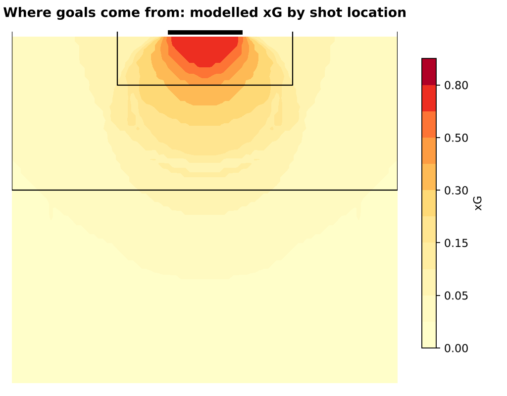
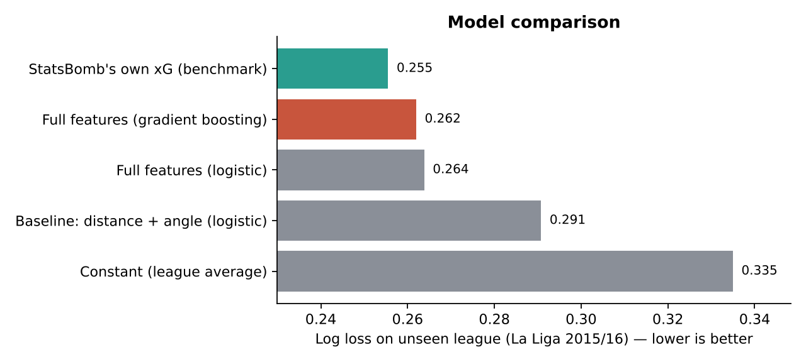
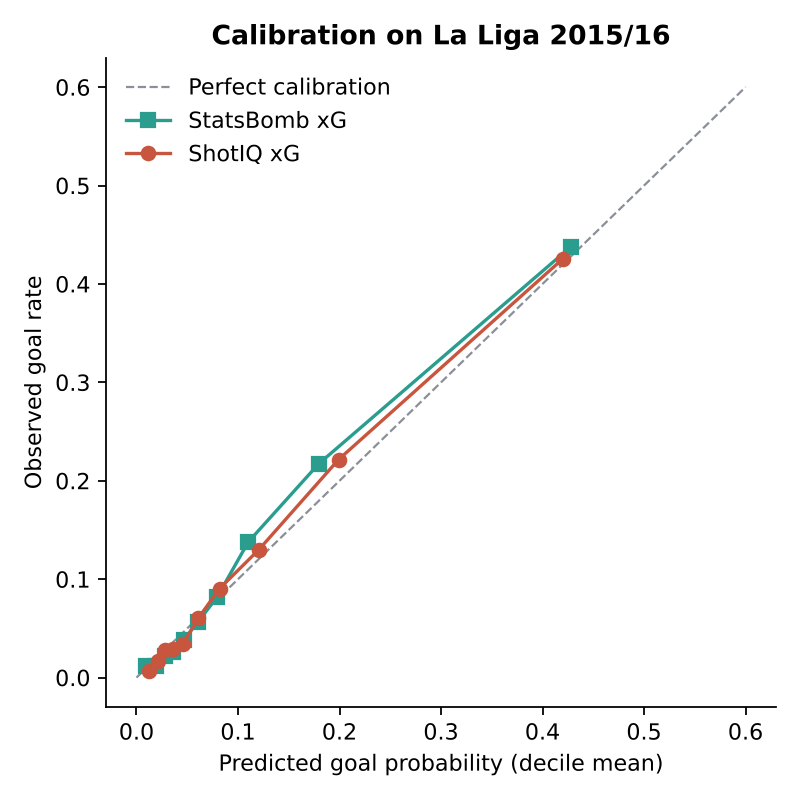
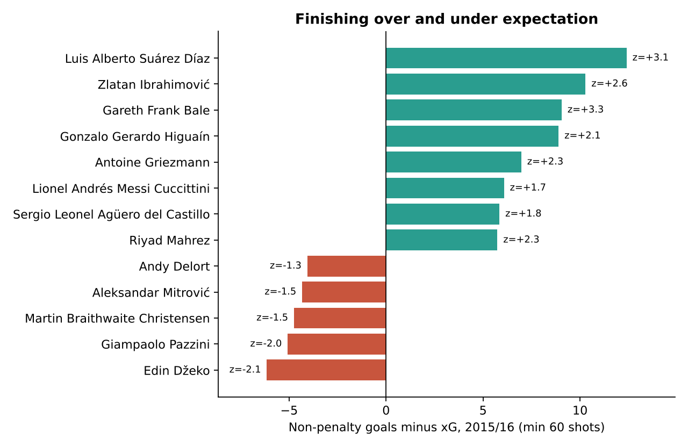
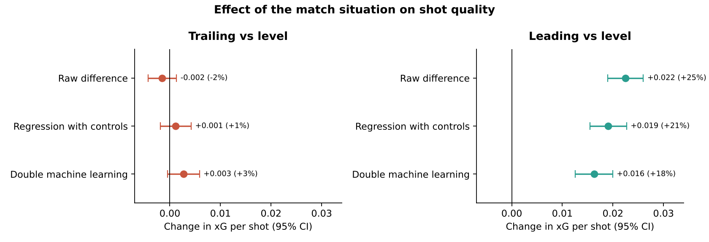
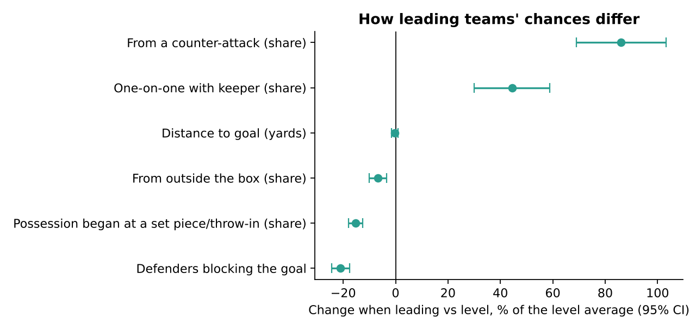
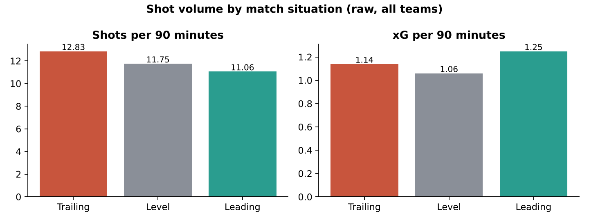
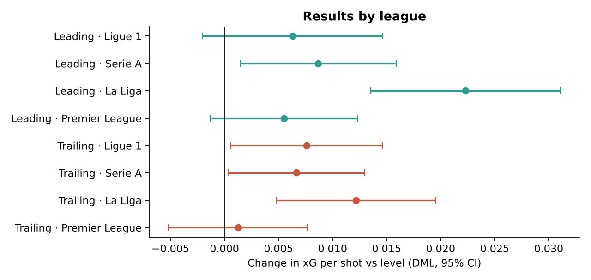

# ShotIQ — an expected-goals (xG) model on StatsBomb data

**How likely was that shot to be a goal?** ShotIQ answers that question for 38,318 non-penalty shots from 1,551 matches across the 2015/16 big-five European leagues. It is then tested on a league it has never seen. A [research extension](#research-extension-does-the-scoreline-change-the-chances-a-team-creates) uses the model to estimate, with causal methods, how the scoreline changes the chances teams create.



## Results

The model was trained on the Premier League, Serie A, Ligue 1 and Bundesliga, and tested on **La Liga 2015/16** (9,071 shots it never saw).

| Model | Log loss ↓ | Brier ↓ | ROC AUC ↑ | Predicted goals (actual 945) |
|---|---|---|---|---|
| Constant (league average) | 0.335 | 0.094 | 0.500 | 839 |
| Distance + angle (logistic) | 0.291 | 0.084 | 0.762 | 881 |
| Full features (logistic) | 0.264 | 0.077 | 0.820 | 937 |
| **Full features (gradient boosting)** | **0.262** | **0.076** | **0.824** | **929** |
| StatsBomb's own xG (benchmark) | 0.256 | 0.074 | 0.833 | 904 |

- **Context beats location alone.** Adding freeze-frame features (where defenders and the goalkeeper were at the moment of the shot) and shot context to distance and angle cuts log loss by 10%.
- **The model gets within 3% of StatsBomb's commercial xG** (log loss 0.262 vs 0.256) on a league it never saw.
- **It is well calibrated.** Predicted 929 goals versus 945 actual in La Liga, and the calibration curve sits close to the diagonal.
- **Finishing skill is visible but rare.** Using out-of-fold xG, Luis Suárez scored 12.4 more non-penalty goals than expected (z = +3.1). Most players sit within normal random variation.





## Research extension: does the scoreline change the chances a team creates?

When teams fall behind they push forward, and when they go ahead they sit deeper. Does this change the **quality** of their chances, or only the **number**? Simply comparing averages is misleading, because stronger teams spend more time ahead and late-game shots are different. This study estimates the causal effect of the match situation on shot quality while controlling for those confounders.

**Design**

- **Treatment:** the score immediately before each shot (trailing, level or leading). It is rebuilt from the full event stream, including own goals. The rebuilt final scores match the official result in all 1,551 matches.
- **Outcome:** ShotIQ's out-of-fold xG per shot. StatsBomb's xG and actual goals are used as robustness checks.
- **Confounders controlled for:**
  - both teams' strength (leave-one-match-out points and goal difference per game)
  - home or away
  - match minute and half
  - the red-card difference
  - league
- **Not controlled for:** shot location, defenders and shot type. These are the channels through which the scoreline can work (mediators), so they are analysed separately instead.
- **Estimators:**
  - the raw difference
  - OLS with controls
  - **double machine learning**: a partially linear model with gradient-boosted nuisance models, 5 folds × 5 repetitions and standard errors clustered by match
- **Further checks:** sensitivity to unmeasured confounding (Chernozhukov et al., 2022), league-by-league estimates, and shot volume per 90 minutes using a Poisson model with time-in-state as the exposure.

**Findings** (38,318 shots; level mean xG = 0.090 per shot)

| Contrast | Raw difference | With controls (OLS) | Double ML (95% CI) |
|---|---|---|---|
| Leading vs level | +0.022 (+25%) | +0.019 (+21%) | **+0.016 (+18%)** [0.013, 0.020] |
| Trailing vs level | −0.002 (−2%) | +0.001 (+1%) | +0.003 (+3%) [−0.000, 0.006] |

1. **Leading teams create better chances.** Each shot is worth about 18% more xG than when level. About a quarter of the raw gap was confounding (better teams lead more often). The effect holds with StatsBomb's xG (+0.017) and with actual goals (+0.015). An unmeasured confounder would need to explain about 5% of the remaining variation in both the scoreline and shot quality to remove it (robustness value 5.6%).
2. **The mechanism is space.** Shots by leading teams come with 21% fewer defenders between ball and goal, 86% more often from counter-attacks and 44% more often one-on-one with the keeper. Shot distance hardly changes.
3. **Trailing teams shoot more, not better.** They take 17% more shots per minute (rate ratio 1.17, 95% CI 1.14–1.21), while the quality of each shot barely moves. The pooled trailing estimate is small and not statistically significant. It is slightly positive in three of the four league-by-league fits, but it changes with the specification and would be erased by very weak unmeasured confounding (robustness value 1%), so I do not claim an effect.
4. **Leading teams trade volume for quality.** They take 12% fewer shots per minute but higher-quality ones.






**Limitations**

- The data covers one season and four full leagues.
- The analysis is conditional on a shot being taken. Volume is analysed separately, but the two are not modelled jointly.
- Team strength is measured from season results, which is an imperfect proxy for tactics and form.
- The sensitivity analysis bounds, but cannot rule out, unmeasured confounding such as in-game tactical changes.

```bash
python scripts/download_game_state.py     # rebuild score and red cards before every shot (~2 min)
python scripts/run_game_state_study.py    # estimates, sensitivity, mechanisms, figures (~4 min)
```

Code: `src/shotiq/game_state.py` (score reconstruction, time in each state, team strength) and `src/shotiq/causal.py` (estimators and sensitivity analysis). Results are in `reports/game_state/`.

## How it works

1. **Download** (`scripts/download_data.py`): fetches every 2015/16 big-five league match from StatsBomb Open Data and keeps one row per shot, including the freeze frame.
2. **Features** (`src/shotiq/features.py`):
   - distance and angle to goal
   - number of defenders in the triangle between the ball and the posts
   - defenders within 3 yards
   - goalkeeper position
   - header, first-time, volley, under pressure, one-on-one, set piece, counter-attack and direct free kick
3. **Models** (`src/shotiq/model.py`): a constant baseline, a two-feature logistic regression, a full logistic regression and a gradient-boosted tree model. All are evaluated on a held-out league.
4. **Analysis** (`scripts/run_analysis.py`):
   - model comparison and calibration
   - xG surface
   - player finishing, using out-of-fold xG from 5-fold cross-validation grouped by match, so no shot is scored by a model that trained on it

## Why each tool

| Tool | Why |
|---|---|
| **StatsBomb Open Data** | Professional-grade event data, free for non-commercial use. It is the only free source with freeze frames (player positions at the moment of each shot). |
| **Python + pandas** | Flattening nested JSON events into a tidy one-row-per-shot table. |
| **scikit-learn** | Logistic regression is the transparent, explainable baseline. `HistGradientBoostingClassifier` captures interactions (for example, a header from close range) without manual feature crosses. |
| **Log loss, Brier and calibration** | xG is a *probability*, so it must be judged on probability quality, not accuracy. A model that always says "no goal" is 90% accurate and useless. |
| **Held-out league + GroupKFold** | Tests the model on unseen data and stops shots from the same match leaking between train and test. |
| **pytest** | Checks the geometry (the penalty spot is 12 yards), the parsing, the exclusion of penalties and the absence of leakage. |
| **matplotlib** | Static, reproducible charts that render on GitHub. |

## Run it

```bash
python -m venv .venv && source .venv/bin/activate   # Windows: .venv\Scripts\activate
pip install -r requirements.txt
python scripts/download_data.py    # ~2 minutes, ~38k shots
python scripts/run_analysis.py     # trains models, writes reports/ and figures
pytest -q                          # 10 tests
```

## Project layout

```
src/shotiq/      data.py (download + parse), features.py, model.py, game_state.py, causal.py
scripts/         download_data.py, run_analysis.py, download_game_state.py, run_game_state_study.py
tests/           test_shotiq.py, test_game_state.py
reports/         model_comparison.csv, player_finishing.csv, summary.json, game_state/, figures/
data/processed/  shots_with_xg.csv (raw downloads are git-ignored)
```

## Limitations

- The data covers a single season (2015/16).
- There is no information on shot height or the player's weaker foot.
- The freeze frame only covers players visible on the broadcast.
- Player finishing results are noisy, so treat z-scores below about 2 as luck rather than skill.

## Data and credit

Data provided by **StatsBomb** (now Hudl StatsBomb) via [StatsBomb Open Data](https://github.com/statsbomb/open-data), used under its non-commercial licence. All analysis and modelling in this repository are my own.
